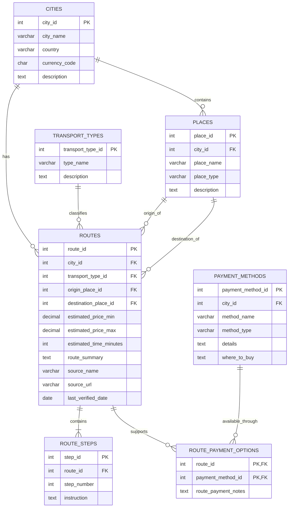

# Database Design — GTG (Global Transportation Guide)

| Course | 192-304 Agile Software Development |
| Project | GTG — Global Transportation Guide |
| Name & ID | Wai Lwin Moe (6905140008)

## 1. Purpose

This document describes the proposed database structure for the GTG MVP. The database stores city information, transport types, popular places, routes, route instructions, and ticket/payment information. The design supports the first three cities: Bangkok, Tokyo, and Singapore.

## 2. Design Overview

A relational database is suitable because the information is connected. For example, one city has many places and routes, while each route uses a transport type and can have several instruction steps. Payment methods can also be connected to more than one route.

The database is designed for prepared information entered and checked by the team. It does not store live vehicle locations, live arrival times, user accounts, or payment transactions because these are outside the MVP scope.

## 3. Entity Relationship Diagram

## 4. Tables and Fields

### 4.1 `cities`

Stores the cities supported by GTG.

| Field | Data type | Key / rule | Description |
|---|---|---|---|
| `city_id` | INT | Primary key | Unique ID for each city |
| `city_name` | VARCHAR(100) | NOT NULL, UNIQUE | City name, for example Bangkok |
| `country` | VARCHAR(100) | NOT NULL | Country name |
| `currency_code` | CHAR(3) | NOT NULL | Currency code used for route price display, for example THB, JPY, or SGD |
| `description` | TEXT | Optional | Short city introduction |

### 4.2 `transport_types`

Stores the transport categories used by routes.

| Field | Data type | Key / rule | Description |
|---|---|---|---|
| `transport_type_id` | INT | Primary key | Unique ID for a transport type |
| `type_name` | VARCHAR(50) | NOT NULL, UNIQUE | Metro/Train, Bus, or Taxi |
| `description` | TEXT | Optional | Short explanation of the transport type |

### 4.3 `places`

Stores airports, city centers, attractions, stations, and other places that users can choose as the start or destination of a route.

| Field | Data type | Key / rule | Description |
|---|---|---|---|
| `place_id` | INT | Primary key | Unique ID for a place |
| `city_id` | INT | Foreign key → `cities.city_id`, NOT NULL | City where the place is located |
| `place_name` | VARCHAR(150) | NOT NULL | Name shown to the user |
| `place_type` | VARCHAR(50) | NOT NULL | For example Airport, City Center, Attraction, or Station |
| `description` | TEXT | Optional | Short information about the place |

Recommended rule: the combination of `city_id` and `place_name` should be unique to avoid duplicate place entries in the same city.

### 4.4 `routes`

Stores the route details that users can search and view.

| Field | Data type | Key / rule | Description |
|---|---|---|---|
| `route_id` | INT | Primary key | Unique ID for a route |
| `city_id` | INT | Foreign key → `cities.city_id`, NOT NULL | City where the route is located |
| `transport_type_id` | INT | Foreign key → `transport_types.transport_type_id`, NOT NULL | Main transport type for the route |
| `origin_place_id` | INT | Foreign key → `places.place_id`, NOT NULL | Starting place |
| `destination_place_id` | INT | Foreign key → `places.place_id`, NOT NULL | Destination place |
| `estimated_price_min` | DECIMAL(10,2) | NOT NULL, >= 0 | Lowest estimated price |
| `estimated_price_max` | DECIMAL(10,2) | NOT NULL, >= minimum price | Highest estimated price |
| `estimated_time_minutes` | INT | NOT NULL, > 0 | Estimated journey time in minutes |
| `route_summary` | TEXT | Optional | Short description of the route |
| `source_name` | VARCHAR(200) | Optional | Name of the source used to check the information |
| `source_url` | VARCHAR(500) | Optional | Link to the source, when available |
| `last_verified_date` | DATE | Optional | Date when the route information was last checked |

The route's origin and destination must belong to the same city recorded in `routes.city_id`. This rule should be checked by the application or a database constraint/trigger where supported.

### 4.5 `route_steps`

Stores the ordered instructions for each route.

| Field | Data type | Key / rule | Description |
|---|---|---|---|
| `step_id` | INT | Primary key | Unique ID for an instruction step |
| `route_id` | INT | Foreign key → `routes.route_id`, NOT NULL | Route that owns the step |
| `step_number` | INT | NOT NULL, > 0 | Position of the step in the instructions |
| `instruction` | TEXT | NOT NULL | Simple-English instruction for the user |

Recommended rule: `route_id` and `step_number` should be unique together so a route does not have two steps with the same number.

### 4.6 `payment_methods`

Stores ticket and payment information available in each city.

| Field | Data type | Key / rule | Description |
|---|---|---|---|
| `payment_method_id` | INT | Primary key | Unique ID for a payment method |
| `city_id` | INT | Foreign key → `cities.city_id`, NOT NULL | City where the method is available |
| `method_name` | VARCHAR(100) | NOT NULL | Name of the card, app, cash option, or ticket method |
| `method_type` | VARCHAR(50) | NOT NULL | For example Cash, Contactless Card, Transport Card, Mobile App, or Ticket |
| `details` | TEXT | Optional | Explanation of how the method works or where it is accepted |
| `where_to_buy` | TEXT | Optional | Where users can buy or top up the card/ticket, when known |

### 4.7 `route_payment_options`

Connects routes to the payment methods that can be used for those routes. This is a linking table because one route can support multiple payment methods, and one payment method can be used on multiple routes.

| Field | Data type | Key / rule | Description |
|---|---|---|---|
| `route_id` | INT | Primary key part; foreign key → `routes.route_id` | Route that supports the payment option |
| `payment_method_id` | INT | Primary key part; foreign key → `payment_methods.payment_method_id` | Payment method available for the route |
| `route_payment_notes` | TEXT | Optional | Extra details about using this method on the route |

The combination of `route_id` and `payment_method_id` is the composite primary key.

## 5. Relationships

| Relationship | Type | Explanation |
|---|---|---|
| City → Places | One-to-many | One city can contain many places; each place belongs to one city |
| City → Routes | One-to-many | One city can have many routes; each route belongs to one city |
| Transport Type → Routes | One-to-many | One transport type can be used by many routes; each route has one main transport type |
| Place → Routes (origin) | One-to-many | A place can be the starting point for many routes |
| Place → Routes (destination) | One-to-many | A place can be the destination for many routes |
| Route → Route Steps | One-to-many | One route can contain multiple ordered instruction steps |
| Routes ↔ Payment Methods | Many-to-many | A route can support several payment methods, and a payment method can apply to several routes; `route_payment_options` connects them |

## 6. Data Validation Rules

1. Each city, transport type, place, route, instruction step, and payment method must have a unique primary key.
2. A place must refer to an existing city.
3. A route must refer to an existing city and transport type.
4. A route's origin and destination must refer to existing places in the same city as the route.
5. The origin and destination should be different places.
6. Estimated prices must be zero or higher, and the minimum must not exceed the maximum.
7. Estimated travel time must be a positive number of minutes.
8. Each route's step numbers must be positive and unique within that route.
9. A route-payment link must refer to an existing route and payment method.
10. The website must label stored prices and times as estimates.
11. The team should record the source and last-verified date for route information whenever possible.

## 7. Example Initial Data

The following are examples of the city records that the MVP is expected to support. They show the intended data structure; route prices, journey times, and payment details must be researched and verified before real records are added.

| city_id | city_name | country | currency_code |
|---:|---|---|---|
| 1 | Bangkok | Thailand | THB |
| 2 | Tokyo | Japan | JPY |
| 3 | Singapore | Singapore | SGD |

Example transport type records:

| transport_type_id | type_name |
|---:|---|
| 1 | Metro/Train |
| 2 | Bus |
| 3 | Taxi |

## 8. Database Design Notes

- The design avoids repeating city and transport-type details in every place or route record.
- The `route_steps` table allows each route to have as many instructions as needed.
- The payment linking table supports different payment options for different routes.
- The source fields help the team review information that may change over time.
- The MVP does not need tables for users, bookings, payments, live vehicle locations, or real-time arrivals because those features are outside the agreed scope.

## 9. Suggested Database Acceptance Checks

- [ ] The database can store the three initial city records.
- [ ] Each place is connected to one valid city.
- [ ] Each route is connected to one valid city, one transport type, one origin, and one destination.
- [ ] A route cannot be saved with a negative price, a minimum price above its maximum, or a travel time of zero or less.
- [ ] A route can have multiple ordered instruction steps.
- [ ] A route can be connected to one or more payment options.
- [ ] Route and payment information can be retrieved for display on the correct city page.
